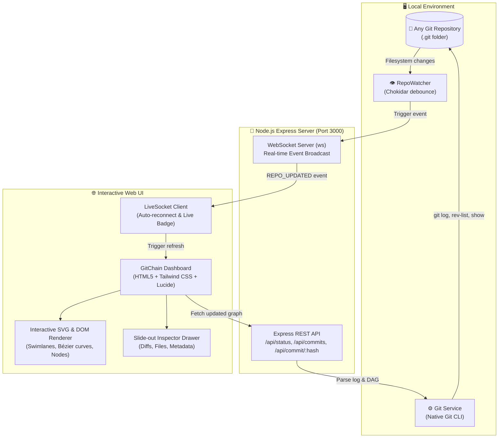

# ⚡ GitChain Live

> **Real-Time Interactive Git Commit Chain & Push Status Visualizer**  
> Connects to any local Git repository (ongoing or completed) and renders a live, interactive topological commit DAG directly in your web browser.

---

## 🌟 Overview

**GitChain Live** gives developers, DevOps engineers, and teams immediate visual clarity over their Git repository history and synchronization state. 

Whenever you run Git commands in your terminal or IDE (`git commit`, `git checkout`, `git merge`, `git push`), **GitChain Live automatically updates the browser diagram in real-time** via WebSockets and filesystem watchers—no manual page refresh required!

---

## ✨ Features

- **🌐 Browser-Based & Connects to Any Project:** Enter any absolute or relative repository directory path (e.g. `C:/Projects/my-app` or `../my-project`) and inspect it immediately.
- **⚡ Real-Time Instant Sync:** Employs low-overhead filesystem event monitoring on `.git/HEAD`, `.git/refs/`, and `.git/index` coupled with WebSocket events to reflect changes instantly.
- **☁️ Clear Pushed vs. Unpushed Commit Distinction:**
  - 🟢 **Pushed Commits:** Solid emerald nodes with a `[✓ Pushed]` badge indicating they are already synchronized with a remote tracking branch (`origin/*`).
  - 🟡 **Local / Unpushed Commits:** Dashed amber glowing nodes with a `[↑ Local]` badge indicating changes exist only locally and need `git push`.
- **🎯 Dynamic Chain & Swimlane DAG Diagram:**
  - Branch fork and merge curves drawn with smooth cubic Bézier splines.
  - Distinct lane colors for branches.
  - Active **`HEAD`** pointer with a pulsating halo.
  - Branch heads, remote references, and tags displayed as styled badges.
- **🔍 Interactive Details & File Diff Drawer:**
  - Click on any commit node or row to slide out a detailed inspector drawer.
  - Full commit hash with 1-click clipboard copy.
  - Author and committer information with relative and ISO timestamps.
  - Complete commit subject and multiline body message.
  - List of changed files with insertions (`+`), deletions (`-`), and status (`[A]dded`, `[M]odified`, `[D]eleted`).
  - Full syntax-highlighted Git unified diff patch view.
  - Clickable Parent & Child lineage links that jump to connected commits in the graph.
- **🔎 Powerful Search & Filters:**
  - Filter by branch (e.g. `main`, `feature/xyz`).
  - Filter by push status (`All`, `Pushed Only`, `Unpushed (Local) Only`).
  - Live search across commit hashes, commit messages, and author names.
- **🧪 Built-In Demo Repo & Git Simulator:**
  - Includes a 1-click demo repository generator with multiple branches, tags, and merge commits.
  - Built-in Git Simulator modal allowing you to trigger simulated commits, branches, merges, and pushes right from the browser.

---

## 🏗️ Architecture



---

## 🚀 Quick Start Guide

### 1. Prerequisites
- **Node.js** (v18.0.0 or higher recommended)
- **Git** (installed and in your system `PATH`)

Check that they are available:
```bash
node -v
git --version
```

---

### 2. Installation

Clone or navigate into the project directory and install the dependencies:

```bash
cd GITSIMULATION
npm install
```

---

### 3. Launching GitChain Live

Start the server:

```bash
npm start
```

You will see:
```text
====================================================
🚀 GitChain Live visualizer running at:
👉 http://localhost:3000
📂 Active repository: C:\Users\...\GITSIMULATION
====================================================
```

Open your browser and navigate to:
```
http://localhost:3000
```

---

### 4. Optional Configurations

You can launch the visualizer pre-connected to any repository by passing the `REPO_PATH` environment variable or changing the port:

#### On Windows (PowerShell):
```powershell
$env:REPO_PATH = "C:\Path\To\Your\Project"; npm start
```

#### On Linux / macOS:
```bash
REPO_PATH="/path/to/your/project" PORT=3000 npm start
```

---

## 📖 How to Use the Tool

### Connecting to Any Repository
1. In the top bar, enter the path to any local Git project (for example `C:/Users/satya/my-project` or `../other-repo`).
2. Click **Connect** (or press Enter).
3. The server validates the repository, connects the watcher, and displays the commit chain diagram instantly.

### Testing with the 1-Click Demo Repository
If you don't have a repository ready to connect, click **"Load Demo Repo"** in the top bar.  
GitChain Live will automatically generate a sample project featuring:
- Active branches (`main`, `feature/jwt-auth`, `feature/stripe-billing`)
- Both pushed and unpushed commits
- Merge commits with multi-parent curves
- Semantic release tags (`v1.0.0`)

### Observing Real-Time Updates
Open your terminal in the connected repository and make a commit:
```bash
git checkout -b feature/awesome-feature
echo "Hello World" >> sample.txt
git add sample.txt
git commit -m "feat: add awesome feature"
```
Look at your browser: the commit node and new branch swimlane appear **immediately without refreshing**.

### Testing with the Git Simulator
1. Click **Git Simulator** in the top-right corner.
2. Click **"Create Commit"**, **"New Feature Branch"**, or **"Push to Remote"**.
3. Watch the changes reflect dynamically in the live diagram.

---

## 📂 Project Structure

```text
GITSIMULATION/
├── server/
│   ├── index.js            # Express & WebSocket server, REST API routes
│   ├── gitService.js       # Git CLI parser (DAG builder, commit log, diffs, push status)
│   └── repoWatcher.js      # Real-time watcher for .git changes using Chokidar
├── public/
│   ├── index.html          # Web UI layout & control panels
│   ├── css/
│   │   └── style.css       # Custom styles, animations, swimlane colors, glow effects
│   └── js/
│       ├── app.js          # Application controller, filters, state, drawer logic
│       ├── gitGraph.js     # Interactive SVG & HTML commit chain DAG renderer
│       └── websocket.js    # WebSocket client with auto-reconnection
├── demo-repo-creator.js    # Standalone script to generate a rich demo repository
├── package.json            # Project manifest & dependencies
└── README.md               # Documentation and usage guide
```

---

## 🔌 API Reference

| Method | Endpoint | Description |
|---|---|---|
| `GET` | `/api/status` | Returns active repository metadata, current branch, HEAD hash, dirty status |
| `GET` | `/api/commits` | Returns complete list of commits organized into DAG lanes with push status |
| `GET` | `/api/commit/:hash` | Returns commit details including author, committer, changed files, and diff patch |
| `POST` | `/api/set-repo` | Switches the active repository to `{ repoPath: "..." }` |
| `POST` | `/api/create-demo-repo` | Generates a rich demo Git repository for instant testing |
| `POST` | `/api/simulate-action` | Executes simulated Git action (`commit`, `branch`, `checkout`, `merge`, `push`) |

---

## ⌨️ Keyboard Shortcuts

| Key | Action |
|---|---|
| `/` | Focus search bar to filter commits |
| `Escape` | Close the commit details drawer or modal |

---

## 🛡️ License

MIT License. Free to use, modify, and distribute.
